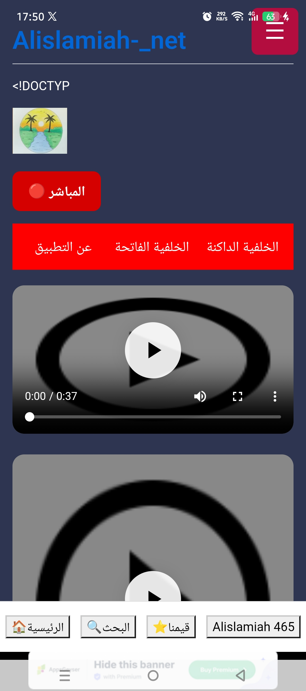
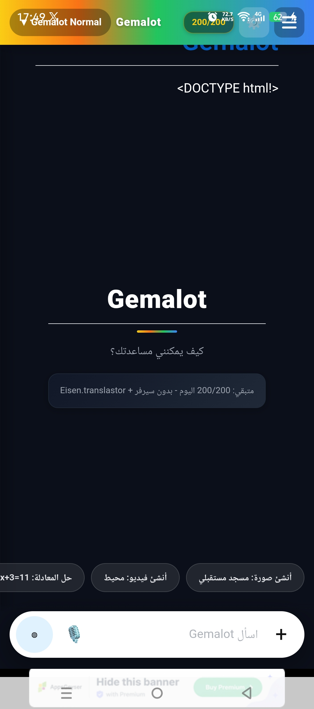

<!DOCTYPE html>
<html lang="ar" dir="rtl">
<head>
  <meta charset="UTF-8">
  <meta name="viewport" content="width=device-width, initial-scale=1.0">
  <title>Alislamiah-Tube</title>

  <link rel="icon" href="icon.png" type="image/png">
  <link href="https://fonts.googleapis.com/css2?family=Cairo:wght@400;600;700&display=swap" rel="stylesheet">

  
</head>
<body>

  <!-- شاشة الترحيب -->
  

    

      <rect width=\'100\' height=\'100\' rx=\'20\' fill=\'%23087fff\'/><text x=\'50\' y=\'65\' font-size=\'50\' text-anchor=\'middle\' fill=\'white\'>▶</text></svg>'">
    

  

  <header class="header">
    
    <h1 id="header-title">Alislamiah-Tube</h1>
  </header>

  <main class="main-content">

    <!-- ==================== البطاقات الإعلانية ==================== -->
    <!-- البطاقة 1 -->
    <a href="https://Alislamiah.github.io/Alislamiah-_net/" class="promo-card active" id="promo0" target="_blank">
      
      

      

        منصة تعليمية
        
Alislamiah.net

        
منصة تعليمية متكاملة ومجانية من الإسلامية

        اكتشف المنصة ←
      

    </a>

    <!-- البطاقة 2 -->
    <a href="https://Alislamiah.github.io/outhub/" class="promo-card" id="promo1" target="_blank">
      <video class="promo-media" muted autoplay loop playsinline>
        <source src="outhub.mp4" type="video/mp4">
      </video>
      

      

        تطوير ويب
        
Outhub

        
منصة تطوير المواقع والتطبيقات من الإسلامية

        ابدأ التطوير ←
      

    </a>

    <!-- البطاقة 3 -->
    <a href="https://Alislamiah.github.io/Gemalot/" class="promo-card" id="promo2" target="_blank">
      
      

      

        ذكاء اصطناعي
        
Gemalot

        
نموذج الذكاء الاصطناعي المطور بواسطة الإسلامية

        جرّب النموذج ←
      

    </a>
    <!-- ==================== نهاية البطاقات ==================== -->

    <h2 class="section-title" id="main-section-title">أحدث الفيديوهات</h2>

    

      <!-- فيديو 1 -->
      <a href="watch.html?v=IMG_20260814_164242_861.mp4&title=ما تيسر من سورة إبراهيم" class="video-card">
        

          <video preload="metadata" muted autoplay loop playsinline>
            <source src="IMG_20260814_164242_861.mp4" type="video/mp4">
          </video>
        

        

          
ما تيسر من سورة إبراهيم

          
Alislamiah-Tube

        

      </a>

      <!-- فيديو 2 -->
      <a href="watch.html?v=lv_0_20260824111719.mp4&title=آيات من سورة مريم بصوت مشاري راشد العفاسي" class="video-card">
        

          <video preload="metadata" muted autoplay loop playsinline>
            <source src="lv_0_20260824111719.mp4" type="video/mp4">
          </video>
        

        

          
آيات من سورة مريم بصوت مشاري راشد العفاسي

          
Alislamiah-Tube

        

      </a>

      <!-- فيديو 3 -->
      <a href="watch.html?v=IMG_20260812_142700_033.mp4&title=بل الساعة موعدهم والساعة أدهى وأمر تلاوة عطرة بصوت الشيخ مشاري العفاسي" class="video-card">
        

          <video preload="metadata" muted autoplay loop playsinline>
            <source src="IMG_20260812_142700_033.mp4" type="video/mp4">
          </video>
        

        

          
بل الساعة موعدهم والساعة أدهى وأمر تلاوة عطرة بصوت الشيخ مشاري العفاسي

          
Alislamiah-Tube

        

      </a>

      <!-- فيديو 4 -->
      <a href="watch.html?v=فرض الفصل الثالث سنة ثالثة متوسط في العلوم الفيزيائية (1).mp4&title=فرض الفصل الثالث سنة ثالثة متوسط في العلوم الفيزيائية (1)" class="video-card">
        

          <video preload="metadata" muted autoplay loop playsinline>
            <source src="فرض الفصل الثالث سنة ثالثة متوسط في العلوم الفيزيائية (1).mp4" type="video/mp4">
          </video>
        

        

          
فرض الفصل الثالث سنة ثالثة متوسط في العلوم الفيزيائية (1)

          
Alislamiah-Tube

        

      </a>

      <!-- فيديو 5 -->
      <a href="watch.html?v=فرض الفصل الثالث سنة ثالثة متوسط في العلوم الفيزيائية.mp4&title=فرض الفصل الثالث سنة ثالثة متوسط في العلوم الفيزيائية" class="video-card">
        

          <video preload="metadata" muted autoplay loop playsinline>
            <source src="فرض الفصل الثالث سنة ثالثة متوسط في العلوم الفيزيائية.mp4" type="video/mp4">
          </video>
        

        

          
فرض الفصل الثالث سنة ثالثة متوسط في العلوم الفيزيائية

          
Alislamiah-Tube

        

      </a>

      <!-- فيديو 6 -->
      <a href="watch.html?v=فرض الفصل الثالث في ماده العلوم الفيزيائيه السنه اولى متوسط.mp4&title=فرض الفصل الثالث في مادة العلوم الفيزيائية السنة الأولى متوسط" class="video-card">
        

          <video preload="metadata" muted autoplay loop playsinline>
            <source src="فرض الفصل الثالث في ماده العلوم الفيزيائيه السنه اولى متوسط.mp4" type="video/mp4">
          </video>
        

        

          
فرض الفصل الثالث في مادة العلوم الفيزيائية السنة الأولى متوسط

          
Alislamiah-Tube

        

      </a>

      <!-- فيديو 7 -->
      <a href="watch.html?v=نموذج مقترح فرض الفصل الثالث سنة ثالثة متوسط.mp4&title=نموذج مقترح فرض الفصل الثالث سنة ثالثة متوسط" class="video-card">
        

          <video preload="metadata" muted autoplay loop playsinline>
            <source src="نموذج مقترح فرض الفصل الثالث سنة ثالثة متوسط.mp4" type="video/mp4">
          </video>
        

        

          
نموذج مقترح فرض الفصل الثالث سنة ثالثة متوسط

          
Alislamiah-Tube

        

      </a>

      <!-- فيديو 8 -->
      <a href="watch.html?v=شرح درس الخطاب المباشر والغير مباشر مكتوب.mp4&title=شرح درس الخطاب المباشر والغير مباشر مكتوب" class="video-card">
        

          <video preload="metadata" muted autoplay loop playsinline>
            <source src="شرح درس الخطاب المباشر والغير مباشر مكتوب.mp4" type="video/mp4">
          </video>
        

        

          
شرح درس الخطاب المباشر والغير مباشر مكتوب

          
Alislamiah-Tube

        

      </a>

<!-- فيديو 9 -->
<a href="watch.html?v=شرح درس Despite and in spite of.mp4&title=شرح درس Despite and in spite of" class="video-card">
  

    <video preload="metadata" muted autoplay loop playsinline>
      <source src="شرح درس Despite and in spite of.mp4" type="video/mp4">
    </video>
  

  

    
شرح درس Despite and in spite of

    
Alislamiah-Tube

  

</a>

<!-- فيديو 10 -->
<a href="watch.html?v=شرح درس Linking words.mp4&title=شرح درس Linking words" class="video-card">
  

    <video preload="metadata" muted autoplay loop playsinline>
      <source src="شرح درس Linking words.mp4" type="video/mp4">
    </video>
  

  

    
شرح درس Linking words

    
Alislamiah-Tube

  

</a>

    

  </main>

  <nav class="bottom-nav">
    <a href="index.html" class="nav-item active">
      🏠
      الرئيسية
    </a>
    <a href="search.html" class="nav-item">
      🔍
      البحث
</a>

    <a href="create.html" class="nav-item">
      ➕
      إنشاء
    </a>

    <a href="Settings.html" class="nav-item">
      ⚙️
      الإعدادات
    </a>
  </nav>

  
</body>
</html>